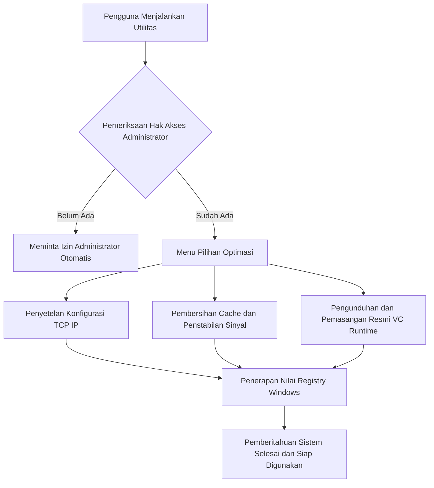

# WARDONE Gaming Network and System Optimizers

Koleksi skrip utilitas otomatisasi Windows untuk optimasi latensi jaringan gaming, penstabilan transfer data USB tethering dan WiFi, serta pemasangan otomatis komponen runtime game Microsoft Visual C++.

Dibuat untuk anggota komunitas WARDONE agar mendapatkan pengalaman bermain game online yang stabil dengan latensi rendah.

## Ikhtisar Utilitas

Paket utilitas ini terdiri dari tiga modul utama:

* Pengoptimal Jaringan dan USB Tethering (KillerLAN.bat): Mengatur parameter TCP/IP Windows, menonaktifkan pelambatan jaringan multimedia tersembunyi, dan mengoptimalkan ukuran jendela penerima jaringan untuk kestabilan ping.
* Pengoptimal Koneksi Nirkabel WiFi (wifibooster.bat): Mengurangi fluktuasi roaming nirkabel, memprioritaskan paket data gaming, dan membersihkan cache DNS jaringan lokal.
* Pemasang Otomatis Pustaka Visual C++ (fixgame.bat): Memeriksa dan memasang paket resmi Microsoft Visual C++ dari versi 2005 hingga versi terbaru untuk mengatasi galat file DLL yang hilang saat menjalankan game.

## Alur Kerja Utilitas

## Panduan Penggunaan

1. Unduh berkas skrip yang dibutuhkan atau gandakan repositori ini ke komputer Windows Anda.
2. Klik kanan pada skrip pilihan Anda, lalu pilih Run as administrator.
3. Ikuti menu interaktif yang ditampilkan di layar konsol.
4. Muat ulang komputer jika diperlukan agar pengaturan jaringan diterapkan sepenuhnya oleh sistem operasi Windows.

## Lisensi

Dirilis di bawah lisensi terbuka MIT License. Hak cipta oleh Yerikho Arfensias Effendi dan Komunitas WARDONE.
